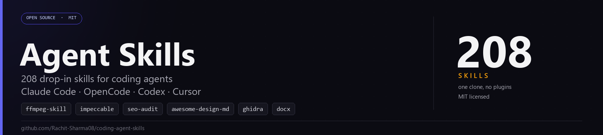
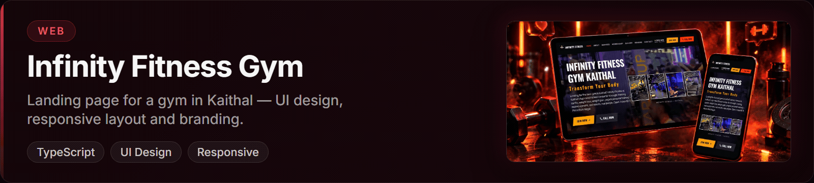
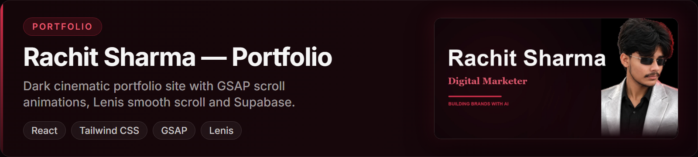
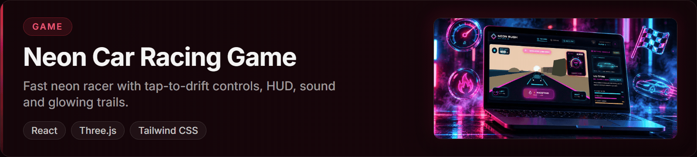
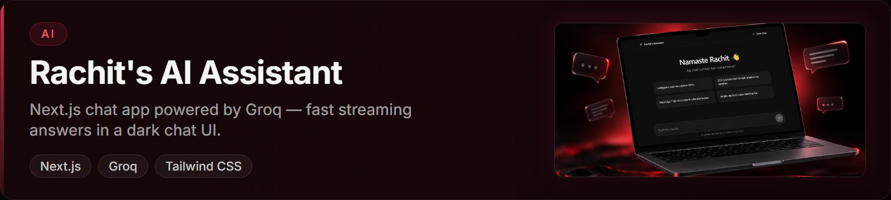

# Rachit Sharma

**Digital marketer in Kaithal, Haryana** — I run Google & Meta ads, help local
businesses get found on Google **and** AI answers, and build the web products
myself with AI.

 

---

## What I do

- **Paid growth** — Google Ads & Meta Ads campaigns structured to convert, not just spend.
- **Search & answer visibility** — SEO, AEO and GEO, so a business shows up in Google results *and* gets cited by AI assistants like ChatGPT and Perplexity.
- **AI-assisted building** — I build and ship real, deployed web products using AI tools (Claude, OpenAI, ElevenLabs, OpenCode). Marketer who can build the funnel end-to-end, not just the ads — and I maintain an open-source library of 208 agent skills.

---

## Now writing

I write about digital marketing, AI search, and the campaigns I run:

- **[dev.to](https://dev.to/rachitsharma08)** — practical marketing + AI experiments
- **[Medium](https://medium.com/@rachitsharma9990888)** — longer deep-dives on SEO, AEO and GEO
- **[LinkedIn](https://www.linkedin.com/in/rachit-sharma08/)** — campaign breakdowns and quick notes

---

## Selected work

### 🧩 Agent Skills — 208 skills for coding agents

An open-source library of 208 skills I actually use — each one is a `SKILL.md` that a coding
agent loads by itself when the request matches: FFmpeg video editing, anti-slop UI design, SEO
and AEO audits, Word/PDF/PPTX generation, Stripe and Supabase patterns, Ghidra for binaries,
plus the workflow skills that stop an agent from free-styling. One clone, no plugin config.

**[Repo](https://github.com/Rachit-Sharma08/coding-agent-skills) · [Catalog](https://github.com/Rachit-Sharma08/coding-agent-skills/blob/main/SKILLS.md) · [Setup](https://github.com/Rachit-Sharma08/coding-agent-skills/blob/main/SETUP.md)**

### 🏋️ Infinity Fitness Gym

A full multi-page responsive website for a gym in Kaithal — 9 pages (Home,
About, Services, Membership, Gallery, Testimonials, Owner, Contact), an AI
chatbot, live open/closed status, membership plans, video gallery, and
WhatsApp + free-trial booking. Built with React, TypeScript, Tailwind CSS and
shadcn/ui.

**[Live](https://fitness-website-nine-chi.vercel.app/) · [Code](https://github.com/Rachit-Sharma08/Fitness-website)**

### 💼 Rachit Sharma — Portfolio

My own dark, cinematic portfolio — GSAP scroll animations, Lenis smooth scroll,
a Supabase-backed blog/CMS, pre-rendered SEO and `/llms.txt` for AI crawlers.

**[Live](https://rachitportfolio-rouge.vercel.app/) · [Code](https://github.com/Rachit-Sharma08/rachitportfolio)**

### 🏎️ Neon Car Racing Game

A 3D neon racer built with Three.js — garage, HUD, countdown and menu screens.
Generated from a single Google AI Studio prompt.

**[Live](https://neon-rush-coral.vercel.app/) · [Code](https://github.com/Rachit-Sharma08/neon-car-racing-game-)**

### 🤖 Rachit's AI Assistant

Next.js chat app with fast streaming answers powered by Groq, in a clean dark
chat UI.

**[Live](https://ai-assistant-one-teal.vercel.app/) · [Code](https://github.com/Rachit-Sharma08/ai-assistant)**

---

## Now

Currently focused on:

- Running Google & Meta ad campaigns for local businesses in Kaithal
- Writing about SEO, AEO and GEO — how to get cited by AI search
- Building more AI-assisted products and client sites

---

## Stack

| | |
|---|---|
| **Marketing** | Google Ads · Meta Ads · SEO · AEO · GEO · Analytics |
| **Building** | React · Next.js · TypeScript · Tailwind CSS · GSAP · Framer Motion |
| **AI** | Claude · OpenAI GPT · ElevenLabs · Cartesia AI · Groq · OpenCode |
| **Platform** | Vercel · Supabase · GitHub |

---

## Work with me

**Let's build something that gets found — and converts.**

I take on freelance work — Google & Meta ad campaigns, SEO/AEO/GEO, and full websites for local businesses.

**[Email me](mailto:rachitsharma9990888@gmail.com) · [LinkedIn](https://www.linkedin.com/in/rachit-sharma08/)**
